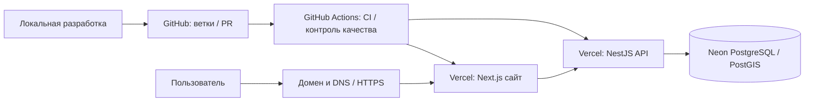

# Полная схема разработки, размещения и работы сайта «Суды России»

**Статус документа:** архитектурный стандарт проекта, редакция от 15 октября 2026 года.  
**Область действия:** разработка, сопровождение, публикация, данные, безопасность, восстановление и качество.  
**Важно:** «Целевая архитектура» ниже — стандарт, к которому проект приводится. Она не означает, что каждый компонент уже создан или введён в эксплуатацию. Реальное состояние на дату проверки приведено отдельно.

## 1. Семь основных уровней архитектуры

| № | Уровень | Задачи и ответственность | Статус/расположение |
| --- | --- | --- | --- |
| 1 | **Локальная разработка** | Создание сайта, программирование, проверка интерфейсов, API и SQL, локальные тесты, изоляция окружений | Исходный код; локально Docker Compose, Next.js, NestJS, PostgreSQL/PostGIS и Python importer. |
| 2 | **GitHub — репозиторий** | Единый источник исходного кода, ветки, история коммитов, Pull Requests, ревью, документация и история решений | [`ymaslen77-tech/sud-court-importer`](https://github.com/ymaslen77-tech/sud-court-importer); рабочая ветка `feat/001-court-portal-foundation`, Draft PR № 1. |
| 3 | **GitHub Actions — CI/CD** | Проверка качества кода, сборка, модульные и интеграционные тесты, Docker smoke, контроль зависимостей и юридических ограничений на данные; релизные проверки и **отдельно разрешённые** миграции | CI уже реализован; автоматические production-миграции и полностью утверждённый CD ещё не считаются готовыми. |
| 4 | **Vercel — основной хостинг** | Сборка и публикация Next.js, SSR/серверные маршруты, HTTPS, preview/production deployment; выполнение выделенного API | Production Next.js: [sudy-rossii.vercel.app](https://sudy-rossii.vercel.app). Отдельное приложение NestJS: [sudy-rossii-api.vercel.app](https://sudy-rossii-api.vercel.app). |
| 5 | **Neon** | Управляемая PostgreSQL, PostGIS, таблицы, пользователи/роли БД, данные, транзакции, управляемые ветки, контроль миграций | Neon `sudy-rossii`, production PostgreSQL `courts`; структура создана, данные предварительной проверки загружены. |
| 6 | **Домен + DNS** | Собственный адрес сайта, управление DNS, привязка домена к Vercel, HTTPS, сертификаты и маршрутизация запросов | Сейчас используются домены `*.vercel.app`. Покупка/подключение отдельного собственного домена — **план**. |
| 7 | **Пользователи сайта** | Открытие страниц, поиск, чтение карточек, использование сервисов; при необходимости — регистрация, вход и персональные функции | Публичная часть размещена; полноценная пользовательская регистрация, роли и личные кабинеты — **отдельный этап**. |

### Фактическая схема взаимодействий

**Упрощённо:**

`Разработка → GitHub → GitHub Actions → Vercel ↔ Neon`

`Пользователь → Домен/DNS → Vercel → Серверная логика → Neon`

В действующем размещении Next.js и NestJS — **два отдельных проекта Vercel**. Next.js запрашивает API по `API_URL`; API обращается к Neon по `DATABASE_URL`. Браузер **не** подключается напрямую к БД и **не** получает её пароль.

## 2. Дополнительные компоненты инфраструктуры

| Компонент | Назначение | Целевое размещение | Текущее состояние |
| --- | --- | --- | --- |
| **Фоновые задачи** | Длительные процессы, импорт, обработка очередей, сравнение источников, отчёты | Отдельный worker/очередь; функции или другой вычислительный сервис — только после проверки поддержки и ограничений | Существуют локальные offline-importer и опциональные профили Docker; отдельный постоянно работающий production worker не развёрнут. |
| **Планировщик** | Регулярные задания, обновления, периодический мониторинг | Vercel Cron или отдельный планировщик с защищённым вызовом worker | Целевое решение. **Автоматический сбор судебных данных не включать** без подтверждения доступа и отдельного разрешения владельца проекта. |
| **Файловое хранилище** | PDF, фотографии, документы, пользовательские вложения и резервные файлы | S3-совместимое объектное хранилище с ограничениями доступа | Production-хранилище не подтверждено; **не размещать** произвольные вложения в GitHub или SQL вместо объектного хранилища. |
| **Авторизация** | Регистрация, вход, сессии, права пользователей и редакторов | Приложение с поддерживаемым провайдером авторизации (возможно Neon Auth при подтверждённой совместимости) | Есть отдельные механизмы локального редактора; готовая безопасная пользовательская production-авторизация и роли не подтверждены. |
| **Мониторинг** | Ошибки, доступность, логи, метрики, производительность, уведомления | Логи Vercel + внешняя система наблюдаемости и проверки доступности | GitHub smoke/health проверки есть; централизованные алерты, SLO и круглосуточный мониторинг требуют внедрения. |
| **Резервное копирование** | Снимки базы и критических данных, контроль хранения и проверенное восстановление | Возможности Neon + независимые зашифрованные резервные копии в другой области хранения | Локальные backup-first скрипты существуют; проверенный **production** план и тест восстановления отдельно не завершены. |
| **Защита** | HTTPS, секреты, разграничение прав, защита API, аудит, ограничение запросов | Vercel, Next.js/NestJS, Neon, защищённое хранилище секретов | HTTPS и закрытые env уже применяются. Оставшиеся задачи: production-аудит редакторских прав, rate limiting, журналы доступа и сценарии инцидентов. |

**Разграничение:** Neon предназначен прежде всего для PostgreSQL и веток БД. Не считать Neon «хостингом Next.js» или готовым постоянно работающим worker. Vercel не заменяет долговременную базу или объектное хранилище. Возможность конкретных Neon Functions/Neon Auth должна подтверждаться доступностью соответствующей функции у провайдера, а не приниматься как факт.

## 3. Стандарт работы и публикации (обязательные 10 этапов)

1. **Development.** Разработка в локальном окружении. Проверяются код, схема данных, пользовательские сценарии, ошибки, безопасность, адаптивность и тесты. Не использовать production-секреты в локальных файлах.
2. **GitHub Branch.** Для каждой задачи — отдельная ветка от актуальной базовой ветки; коммиты должны описывать изменения. Секреты и персональные данные не коммитить.
3. **Pull Request.** Ревью, GitHub Actions, TypeScript/Python тесты, тесты API, Docker smoke и проверка безопасности. Изменения в судебных данных требуют отдельной проверки первоисточников.
4. **Preview Deployment.** Для Pull Request — предварительная версия Vercel, не привязанная к рабочему домену. Preview использует собственные env и не должен записывать в production БД. Публичную SEO-индексацию preview отключать.
5. **Staging Database.** Отдельная ветка Neon для тестов схемы, миграций и сценариев приложения. Проверить, что connection string указывает именно на staging; не допускать записи синтетических тестов в production. После теста ветку можно удалить по согласованной политике.
6. **Merge в `main`.** Только после успешного CI, проверки preview, редакционной/юридической приёмки применимых материалов и утверждения релиза ответственным лицом. Draft PR **не** сливать автоматически.
7. **Production Deployment.** Публикация разрешённого коммита из `main` с production-настройками Vercel, HTTPS, безопасными env и контролем доступности. В целевой модели CD автоматизирован; текущий проект не следует считать полностью настроенным на этот режим.
8. **Database Migrations.** Контролируемое изменение схемы: снимок/backup, dry-run на отдельной ветке Neon, проверка SHA-256 и применённой истории, атомарное применение, мониторинг. **Порядок SQL и выкладки кода зависит от совместимости:** безопасные расширяющие миграции выполняются *до* релиза кода, несовместимые/удаляющие — отдельным последующим релизом после проверки. Не запускать произвольную миграцию при каждом HTTP-запросе или без разрешения.
9. **Monitoring.** Внешний health-check, наблюдение за логами и ошибками, проверка SEO, контроль подтверждённых записей, тревоги и ручная приемка критических пользовательских маршрутов.
10. **Rollback.** Откат к предыдущему проверенному deployment Vercel. Для БД — **отдельная** стратегия восстановления из тестированной копии или безопасная компенсирующая миграция, с учётом потерянных/новых транзакций и совместимости схемы. Откат кода сам по себе **не** откатывает PostgreSQL.

### Контрольные условия релиза (release gates)

- CI зелёный на **конкретном SHA** коммита, который предлагается выпускать. Прежние зелёные сборки не удостоверяют новый код.
- Preview доступен, smoke и маршруты проходят, migration/staging тесты успешны; нет неконтролируемых изменений данных.
- Vercel Production имеет необходимые `API_URL`, `PUBLIC_SITE_URL`; API — `DATABASE_URL` и допустимый `WEB_ORIGIN`. Секреты хранятся только в защищённых настройках, не в документации и не в Git.
- `GET /api/v1/health` даёт `200` только при доступной БД. `GET /api/status` сообщает исследовательский статус отдельно от подтверждённых записей.
- Публичные карточки имеют подтверждённый источник и дату индивидуальной редакционной сверки. Исследовательские записи сохраняют `noindex`, исключаются из sitemap и не маркируются `verified`.
- Отдельно проверены доступность домена и HTTPS, разграничение прав, журнал ошибок, восстановление и откат.
- При ошибке сборки, квоте Vercel, неготовой БД или юридическом блокере релиз **останавливается**, а последнее работающее production-развёртывание сохраняется.

## 4. Распределение ответственности

| Сервис/команда | За что отвечает | За что **не** отвечает |
| --- | --- | --- |
| **GitHub** | Исходный код, ветки, история, PR, ревью и согласования | Не является production-сервером и рабочей БД |
| **GitHub Actions** | Проверки, тесты, сборка, утверждённые автоматические операции | Не доказывает актуальность реальных судебных сведений одним зелёным CI |
| **Vercel** | Публичный Next.js, серверные маршруты и отдельный API, deployment, HTTPS и preview | Не является основным PostgreSQL-хранилищем и долгосрочным хранилищем пользовательских файлов |
| **Neon** | Основная PostgreSQL/PostGIS, схема, транзакции, ветки БД, согласованные миграции | Не размещает автоматически весь веб-сайт и не проверяет юридическую достоверность судебных карточек |
| **Домен/DNS** | Публичный адрес, записи DNS, направление трафика, проверка сертификатов | Не подменяет хостинг, авторизацию и БД |
| **Редактор проекта** | Проверка официального источника, судебной идентичности, состава, подсудности и прав на использование данных; допуск записи к публикации | Не должен обходить очередь `pending` прямой массовой публикацией |
| **Ответственный за эксплуатацию** | Управление доступом, release-gate, мониторинг, инциденты, backups и rollback | Не считается назначенным автоматически из факта наличия репозитория |

## 5. Окружения и секреты

| Среда | Код | Хостинг | База | Доступ |
| --- | --- | --- | --- | --- |
| Development | Локальная рабочая копия | Windows/Docker Compose | Локальный PostgreSQL/PostGIS | Только разработчику |
| Pull Request / Preview | Ветка GitHub и проверяемый SHA | Vercel Preview | Отдельная Neon staging branch, когда настроена | Ограниченный; не production данные |
| Production | Утверждённый commit/релиз в `main` (целевой стандарт) | Vercel `sudy-rossii` + `sudy-rossii-api` | Neon `sudy-rossii` / `courts`, production | Публичный сайт; API по правилам доступа |

**Основные переменные:** `PUBLIC_SITE_URL` (канонический публичный URL), `API_URL` (серверный адрес API в Next.js), `DATABASE_URL` (строка PostgreSQL **только в серверном окружении API**), `WEB_ORIGIN` (допустимый origin браузерных запросов), секреты редактора/авторизации — только там, где они необходимы. Не выводить секреты в CI, PR, логи, документацию или браузерный JavaScript. Для фоновых процессов использовать отдельную роль БД с минимальными правами.

Рабочая Neon DB и «закрытые редакционные очереди в production PostgreSQL» — **не то же самое**, что независимая staging branch Neon. Очереди `court_import_rows`/`court_discovery_rows` находятся в рабочей базе, но не являются общедоступными судебными карточками.

## 6. Состояние фактической эксплуатации на 15.10.2026

| Объект | Фактическое состояние | Что ещё нужно |
| --- | --- | --- |
| GitHub | Репозиторий `ymaslen77-tech/sud-court-importer`, `feat/001-court-portal-foundation`, Draft PR № 1, **не** слито в `main` | Утверждённый review и контролируемый merge |
| GitHub Actions | Проверка текущей рабочей ветки, включая SHA `408b45bb`, прошла успешно | Надёжная release-gate политика, полнота security и production e2e |
| Vercel Next.js | `sudy-rossii` — проект и публичный домен, deployment READY | Последние UI-изменения рабочей ветки ещё могут отсутствовать на production: требуется отдельный деплой и проверка SHA |
| Vercel API | `sudy-rossii-api` — отдельный проект, deployment READY, Neon подключён | Финальная проверка защищённости редактора и API в production |
| Neon | PostgreSQL 16 / PostGIS, БД `courts`; **13** миграций; **76** `court_import_rows` + **197** `court_discovery_rows` = **273** строк в закрытых очередях | Индивидуальная юридическая и редакционная приёмка, дальнейшее достоверное наполнение |
| Публичный реестр | **0** утверждённых строк в `courts`; **151** исследовательская целевая страница из сохранённых файлов | Проверка и публикация конкретных судов, разграничение `verified`/`pending`, SEO после приёмки |
| Домен | `sudy-rossii.vercel.app` | Собственный домен и его DNS — если выбран владельцем |
| Дополнительные сервисы | Частичные локальные средства импорта, миграций и CI | Staging DB как отдельный постоянно используемый контур, worker, cron, S3, production Auth, наблюдаемость, резервное восстановление |
| Последняя публикация | Предыдущая попытка новой сборки Next.js была отклонена ограничением Vercel `402 payment_required`/суточной квотой | Проверять действующую квоту и фактический продакшен SHA при следующем релизе; не считать GitHub-коммит автоматически опубликованным |

Этот раздел — **срез на дату проверки**, а не вечное утверждение о лимитах, работоспособности или числе судов. При изменениях в Neon/Vercel обновлять его по фактическим проверкам.

## 7. Ссылки на процедуры

- [Локальная разработка и запуск](../README.md)
- [Публикация Vercel и подключение Neon](./vercel-neon-launch.md)
- [Журнал загрузки судов в Neon](./neon-court-staging-2026-10-14.md)
- [Статус редакционной и юридической приёмки](./acceptance-status.md)
- [Правила поиска и подсудности](./court-search-jurisdiction-2026-10-14.md)
- [Проверка источников данных](./source-channel-verification-2026-10-14.md)

## 8. Критерий полного завершения

Полностью готовая промышленная эксплуатация означает **не только** доступные Vercel и Neon, но и: согласованный PR из `main`, работающий CD с защитой production, отдельную staging БД, подтверждённый домен/HTTPS, авторизацию и права доступа, фоновые задачи при необходимости, безопасное хранилище файлов, мониторинг/оповещения, проверенные бэкапы и восстановление, а также юридически подтверждённые опубликованные карточки судов. Пока эти требования не выполнены, обозначать отдельно **готовность инфраструктуры**, **готовность функций** и **достоверность наполнения**.
